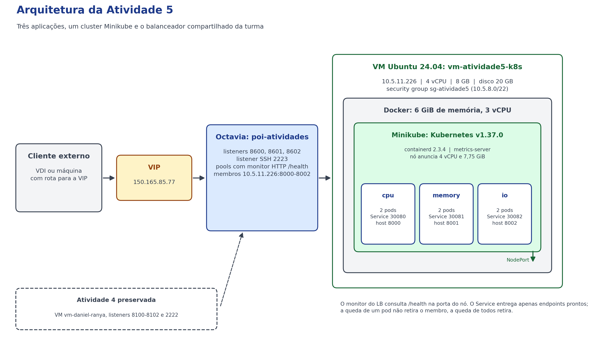

# Plataforma Kubernetes com três perfis de carga

**Atividade 5 — Computação em Nuvem (IaaS)**

Grupo `daniel-ranya`

Daniel Anderson de Souza Silva · Ranya Duran Greco

23 de novembro de 2026

---

## Escopo

- Três serviços HTTP: CPU, memória e entrada e saída
- Contrato comum: `GET /health`, `GET /work?size=N`, `GET /metrics`
- VM Ubuntu 24.04 com 4 vCPU e 8 GB
- Cluster Minikube de nó único
- Exposição pelo balanceador compartilhado da turma
- Atividade 4 preservada nos listeners 8100 a 8102

---



---

## VM e acesso

| Item | Valor |
| --- | --- |
| Instância | `vm-atividade5-k8s` |
| ID | `8c77dbe6-dd33-43ba-9d96-939ddfd5effa` |
| Sabor | `general.large` (4 vCPU, 8192 MB, 20 GB) |
| Endereço | `10.5.11.226`, rede `provider` |
| SSH | listener 2223 do balanceador → porta 22 |
| Firewall | `sg-atividade5`, apenas `10.5.8.0/22` |

Sem IP flutuante.

---

## Cluster

| Componente | Versão |
| --- | --- |
| Ubuntu | 24.04.3 LTS |
| Docker | 29.1.3 |
| kubectl | v1.37.2 |
| Minikube | v1.39.0 |
| Kubernetes | v1.37.0 |
| containerd | 2.3.4 |

Driver Docker, swap desligado, `metrics-server` habilitado.

---

## Dimensionamento: cota e capacidade anunciada

- `--memory=6144` virou `memory.max = 6442450944` (6 GiB)
- `--cpus=3` **não** criou cota no Minikube v1.39.0
- `20-cluster.sh` aplica `docker update --cpus=3` e falha se `CpuQuota` for zero
- Resultado: `cpu.max = 300000 100000`
- Kubelet anuncia 4 vCPU e 8131812Ki, a capacidade do host
- Requests: 1,2 vCPU e 1,5 GiB
- Limits: 5 vCPU e 5 GiB, tetos acima da capacidade anunciada

---

## Manifestos

- Onze objetos em nove arquivos do Kustomize: namespace, 3 Deployments, 3 Services, LimitRange, 3 PDB
- Duas réplicas por Deployment
- `RollingUpdate` com `maxUnavailable: 0` e `maxSurge: 1`
- Histórico de três revisões
- Sondas `startup`, `readiness` e `liveness` em `/health`
- `emptyDir` em `/tmp` para o perfil de I/O

---

## Segurança e disponibilidade

- Pod Security Admission `restricted` no namespace
- Pod fora do perfil é rejeitado com quatro violações
- UID/GID 10001, raiz somente leitura, `seccomp` `RuntimeDefault`
- Sem escalada de privilégio, todas as capacidades removidas
- Token da conta de serviço não montado
- `LimitRange`: 100m/128Mi e 500m/512Mi como padrão
- `PodDisruptionBudget`: `minAvailable: 1`

---

## Exposição pelo balanceador

| Serviço | Externa | Interna | Monitor |
| --- | --- | --- | --- |
| CPU | 8600 | 8000 → 30080 | HTTP `/health`, 5 s |
| Memória | 8601 | 8001 → 30081 | HTTP `/health`, 5 s |
| I/O | 8602 | 8002 → 30082 | HTTP `/health`, 5 s |
| SSH | 2223 | 22 | TCP |

Instância `ACTIVE` referenciada por ID; a instância em `ERROR` não foi tocada.

---

## Verificação externa

| Serviço | 30 amostras | Média | p95 |
| --- | --- | --- | --- |
| CPU A5 | 200 em 30 | 25,8 ms | 32,7 ms |
| Memória A5 | 200 em 30 | 21,9 ms | 26,0 ms |
| I/O A5 | 200 em 30 | 23,1 ms | 32,8 ms |
| CPU A4 | 200 em 30 | 21,4 ms | 25,2 ms |
| Memória A4 | 200 em 30 | 20,5 ms | 24,1 ms |
| I/O A4 | 200 em 30 | 19,8 ms | 21,7 ms |

180 requisições, todas 200.

---

## Testes de falha

- **Pod excluído:** 232 requisições, nenhuma falha
- **Imagem inválida + rollback:** 80 requisições em 80 s, todas 200
- **Todas as réplicas fora:** membro do pool vai a `ERROR`
- **Retorno das réplicas:** membro volta a `ONLINE` em 20 s
- **`minikube stop` e `start`:** seis pods voltam a `Running`

O Service só entrega a endpoints prontos.

---

## Limitações

- Nó único: queda da VM interrompe as três aplicações
- Balanceador concentra entrada administrativa e tráfego
- Monitor do LB observa a porta do nó, não o pod
- Sem rota direta da VDI para a rede `provider`
- Tracebacks de conexão abortada nos logs de memória e I/O
- Limites de CPU somam 5 vCPU, acima dos 4 anunciados

---

## Demonstração

```bash
for p in 8600 8601 8602; do
  curl -sS http://150.165.85.77:$p/health
  curl -sS "http://150.165.85.77:$p/work?size=10"
done
```

```bash
kubectl -n workloads get deploy,pods,svc
kubectl -n workloads get pdb,limitrange
```

Obrigado.
