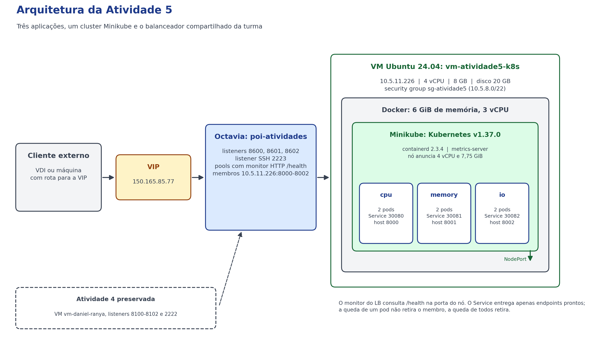

# Relatório de implantação: plataforma Kubernetes

| Campo | Valor |
| --- | --- |
| Grupo | `daniel-ranya` |
| Alunos | Daniel Anderson de Souza Silva; Ranya Duran Greco |
| Matrículas | 0126015852-52M; 0126015844-44M |
| Repositório | https://github.com/DanielAndersonTI/k8s-workload-platform |
| Data da implantação | 22 e 23 de novembro de 2026 |

## Introdução

Três serviços HTTP com perfis distintos de consumo compõem a carga deste trabalho: CPU, memória e entrada e saída. Os três expõem o mesmo contrato, com `/health`, `/work` e `/metrics`, e recebem limites de recursos próprios. O ambiente da Atividade 4 permanece em execução no mesmo projeto.

A implantação usa uma VM dedicada, um cluster Minikube de nó único e o balanceador compartilhado da turma. O objetivo é expor os serviços em portas externas estáveis, preservar o ambiente anterior e verificar o comportamento sob falha. O método combina manifestos versionados, scripts de provisionamento e uma evidência por tarefa.

A figura 1 resume o caminho entre o cliente externo e os pods.



*Figura 1 – Arquitetura da Atividade 5.*

## 1. Configuração da VM e ambiente da Cloud

### 1.1 Instância

A instância `vm-atividade5-k8s` foi criada no projeto `Provisionamento`, com a imagem `ubuntu-24.04` e o sabor `general.large`. O `cloud-init` terminou antes da instalação do cluster, e a máquina não recebeu volume adicional. A tabela 1 reúne os dados da instância.

| Campo | Valor |
| --- | --- |
| ID | `8c77dbe6-dd33-43ba-9d96-939ddfd5effa` |
| Projeto | `Provisionamento` (`2c593796f29e4b829b1b523775e2fa26`) |
| Imagem | `ubuntu-24.04` (625476096 bytes) |
| Sabor | `general.large`, 4 vCPU, 8192 MB, 20 GB |
| Zona | `nova` |
| Sistema | Ubuntu 24.04.3 LTS |
| Recursos vistos pela VM | 4 vCPU, 7941 MB, 19 GB em `/` |
| Endereço | `10.5.11.226`, rede `provider` |

O sabor oferece 4 vCPU, 8192 MB e 20 GB, mas a VM enxerga 7941 MB e 19 GB em `/`. A diferença é compatível com firmware, kernel e sistema de arquivos. O disco atendeu ao sistema, às imagens e ao nó, sem volume extra.

### 1.2 Rede e acesso

O acesso não usa IP flutuante: a entrada administrativa é o listener TCP `ssh-atividade5`, na porta 2223 do balanceador, que encaminha para a porta 22 da VM. O grupo `sg-atividade5` libera SSH, as portas 8000 a 8002 e ICMP apenas a partir de `10.5.8.0/22`.

As portas 8000 a 8002 atendem aos membros do pool, não a clientes externos. A dependência do balanceador vale também para a administração: sem ele, o acesso resta ao console do OpenStack. Essa limitação vale para a conferência e para a demonstração.

### 1.3 Recursos preservados

A VM `vm-daniel-ranya`, os três containers e os listeners 8100 a 8102 e 2222 da Atividade 4 permaneceram ligados. A instância `ERROR` do balanceador `poi-atividades` já existia e não foi tocada; as criações ocorreram na instância `ACTIVE`, referenciada por ID.

Nenhum recurso de outro grupo foi criado, alterado ou removido. As imagens `1.0.0` da Atividade 4 foram republicadas por engano durante a publicação da A5 e restauradas em seguida, com digest confirmado; o incidente está na seção 4.

## 2. Deploy e configuração do cluster Kubernetes

### 2.1 Instalação

O cluster usa o driver Docker do Minikube, escolhido porque o Docker já fazia parte do ambiente e não exige módulo de kernel adicional (MINIKUBE, 2026). O script de instalação também desligou o swap e comentou a linha correspondente no `fstab`. A tabela 2 apresenta as versões instaladas.

| Componente | Versão |
| --- | --- |
| Ubuntu | 24.04.3 LTS |
| Docker | 29.1.3 |
| kubectl | v1.37.2 |
| Minikube | v1.39.0 |
| Kubernetes | v1.37.0 |
| containerd | 2.3.4 |

O nó ficou `Ready` com os pods de sistema em execução, e o `metrics-server` foi habilitado para permitir a leitura de consumo por `kubectl top`. A verificação ocorreu antes de qualquer manifesto de aplicação, o que separa falha de instalação de falha de deploy.

### 2.2 Dimensionamento do cluster

O nó foi iniciado com 3 vCPU e 6144 MB, mas o limite efetivo depende do cgroup do container, não do valor anunciado pelo kubelet. O driver Docker aplica `--memory` como limite, porém o Minikube v1.39.0 não criou cota de CPU a partir de `--cpus` (MINIKUBE, 2026).

O `20-cluster.sh` passou a aplicar `docker update --cpus=3` e a encerrar com erro se a cota continuar ausente (DOCKER, 2026a). Depois do ajuste, `cpu.max` mostra `300000 100000` e `memory.max`, 6442450944 bytes, o que dá 3 vCPU e 6 GiB ao container. O kubelet anuncia 4 vCPU e 8131812Ki.

Os percentuais de `kubectl top` usam a capacidade anunciada, não a cota. A soma dos requests dos seis pods, 1,2 vCPU e 1,5 GiB, cabe nas duas leituras. A soma dos limites, 5 vCPU e 5 GiB, excede os 4 vCPU anunciados e fica abaixo dos 6 GiB de memória; limites são tetos, não reservas.

### 2.3 Decisões de configuração

A tabela 3 reúne as escolhas que sustentam o comportamento observado.

| Objeto | Escolha | Justificativa |
| --- | --- | --- |
| Carga de trabalho | `Deployment` | As aplicações não guardam estado e não precisam de identidade estável |
| Réplicas | 2 | Uma réplica atende enquanto a outra é recriada ou atualizada |
| Estratégia de atualização | `RollingUpdate`, `maxUnavailable: 0` | Nenhum pod antigo sai antes de um novo ficar pronto |
| Serviço | `NodePort` 30080 a 30082 | O Minikube não oferece controlador de nuvem para criar `LoadBalancer` |
| Sondas | `startup`, `readiness` e `liveness` em `/health` | Separam início, entrada no Service e reinício por falha |
| Recursos | `requests` e `limits` por perfil | Garantem agendamento e limitam o consumo de cada aplicação |
| Segurança | UID 10001, raiz somente leitura, sem privilégios, `seccomp` | A aplicação não precisa de privilégio nem de escrita na imagem |
| Armazenamento | `emptyDir` em `/tmp` | Apenas o perfil de I/O grava arquivos temporários |
| Namespace | Pod Security Admission `restricted` | Rejeita pods fora do perfil restrito |
| Interrupção | `PodDisruptionBudget` com `minAvailable: 1` | Preserva uma réplica em manutenção voluntária |
| Padrões | `LimitRange` no namespace | Define recursos para containers que os omitem |

Os limites seguem o perfil de cada aplicação (KUBERNETES, 2026g): CPU recebe requests de 250m e 128Mi e limites de 1 vCPU e 512Mi. Memória recebe 250m e 512Mi, com limites de 1 vCPU e 1536Mi, e I/O recebe 100m e 128Mi, com limites de 500m e 512Mi.

A política `restricted` do namespace rejeita pods fora do perfil, e o `LimitRange` define recursos para containers que os omitem (KUBERNETES, 2026d, 2026f). Os `PodDisruptionBudget` de `minAvailable: 1` preservam uma réplica em interrupção voluntária (KUBERNETES, 2026e). As sondas em `/health` separam início, entrada no Service e reinício (KUBERNETES, 2026c).

## 3. Deploy das aplicações

### 3.1 Imagens

As imagens foram construídas em 23 de novembro de 2026, para `linux/amd64`, e publicadas no Docker Hub (DOCKER, 2026b). Cada uma ocupa cerca de 44,3 MB comprimida e foi lida sem autenticação, o que confirma o acesso público. A tabela 4 relaciona imagens, portas e exposição.

| Aplicação | Imagem | Porta interna | Porta do nó | Porta externa |
| --- | --- | --- | --- | --- |
| CPU | `danielandersonss/poi-cpu:1.1.0` | 8000 | 30080 | 8600 |
| Memória | `danielandersonss/poi-memory:1.1.0` | 8000 | 30081 | 8601 |
| I/O | `danielandersonss/poi-io:1.1.0` | 8000 | 30082 | 8602 |

Os digests publicados foram `e3d6931e83aa` para CPU, `dc65bb896626` para memória e `875c7f03f4ac` para I/O. O `docker pull` na VM devolveu os mesmos identificadores, o que liga o manifesto à imagem baixada, com conferência nas evidências T4.1 e T4.4.

### 3.2 Manifestos

O diretório `k8s/` contém um namespace, três Deployments, três Services, um `LimitRange` e três `PodDisruptionBudget`, onze objetos em nove arquivos reunidos pelo `kustomization.yaml`. A aplicação usa `kubectl apply -k k8s/` e espera o rollout de cada Deployment antes de seguir.

Cada Deployment declara duas réplicas, histórico de três revisões e `RollingUpdate` com `maxUnavailable: 0` (KUBERNETES, 2026a). O pod roda como usuário 10001, com raiz somente leitura, sem escalada de privilégio, `seccomp` em `RuntimeDefault` e todas as capacidades removidas, e o token da conta de serviço não é montado.

A política `restricted` foi verificada com um pod sem contexto de segurança, rejeitado com quatro violações. Um pod compatível e sem `resources` recebeu os padrões do `LimitRange`, e os seis pods ficaram `Running`, com dois endereços por EndpointSlice. As evidências estão em T5.6.

### 3.3 Exposição pelo balanceador

O balanceador `poi-atividades` é compartilhado pela turma e tem duas instâncias com o mesmo nome. O script seleciona a instância `ACTIVE` e passa a referenciá-la pelo ID `57c2b14a-b746-4f34-8719-d0627e409609`, o que evita que a linha de comando atinja a instância em `ERROR`. A tabela 5 apresenta listeners, pools e membros.

| Listener | Porta | Pool | Membro |
| --- | --- | --- | --- |
| `app-cpu-atividade5` | 8600 | `pool-app-cpu-atividade5` | `10.5.11.226:8000` |
| `app-memory-atividade5` | 8601 | `pool-app-memory-atividade5` | `10.5.11.226:8001` |
| `app-io-atividade5` | 8602 | `pool-app-io-atividade5` | `10.5.11.226:8002` |
| `ssh-atividade5` | 2223 | `pool-ssh-atividade5` | `10.5.11.226:22` |

Os quatro listeners ficaram `ACTIVE/ONLINE`, os quatro membros, `ONLINE`, e o monitor HTTP consulta `/health` a cada 5 s, com timeout de 4 s e três tentativas (OPENSTACK, 2026). O Service entrega tráfego apenas a endpoints prontos, e o NodePort mantém a porta aberta enquanto houver uma réplica pronta (KUBERNETES, 2026b).

A queda de um pod não retira o membro do pool, porque a outra réplica continua atendendo. A queda de todas as réplicas interrompe o NodePort e leva o membro a `ERROR`; com o retorno, ele volta a `ONLINE` em 20 s, distinção medida e registrada em T7.7.

### 3.4 Verificação

As medições partiram da VDI, que tem rota para a VIP `150.165.85.77`. Cada porta recebeu 30 amostras de `/health`, e a tabela 6 apresenta média e p95 por serviço. O tempo inclui o balanceador e o caminho completo até o pod.

| Serviço | URL | Amostras | Média | p95 |
| --- | --- | --- | --- | --- |
| CPU A5 | `http://150.165.85.77:8600/health` | 30 | 25,8 ms | 32,7 ms |
| Memória A5 | `http://150.165.85.77:8601/health` | 30 | 21,9 ms | 26,0 ms |
| I/O A5 | `http://150.165.85.77:8602/health` | 30 | 23,1 ms | 32,8 ms |
| CPU A4 | `http://150.165.85.77:8100/health` | 30 | 21,4 ms | 25,2 ms |
| Memória A4 | `http://150.165.85.77:8101/health` | 30 | 20,5 ms | 24,1 ms |
| I/O A4 | `http://150.165.85.77:8102/health` | 30 | 19,8 ms | 21,7 ms |

As 180 requisições retornaram 200, com média entre 19,8 ms e 25,8 ms e p95 entre 21,7 ms e 32,8 ms. A primeira chamada ao perfil de I/O, antes da estabilização do pool, levou 322 ms, enquanto as 30 amostras finais ficaram entre 19,1 ms e 38,7 ms.

As três portas novas responderam também a `/work` e `/metrics`. CPU devolveu o hash de dez iterações, memória devolveu 32 MiB alocados e o checksum, e I/O devolveu 1 MiB lido e escrito, sempre com o mesmo contrato.

### 3.5 Testes de falha

Um pod do `cpu-workload` foi excluído enquanto um laço na VDI fazia uma requisição a cada 0,2 s. O Deployment repôs a réplica e o Service manteve a segunda atendendo, e o laço completou 232 requisições, todas com 200.

Uma atualização para a imagem `nao-existe` foi rejeitada pelo kubelet: o pod novo ficou em `ImagePullBackOff`, e as duas réplicas antigas continuaram prontas. O `rollout undo` restaurou a imagem `1.1.0` sem interrupção. Um laço de uma requisição por segundo registrou 80 respostas 200 em 80 s.

Um `minikube stop` seguido de `minikube start` interrompeu as URLs por alguns minutos. Após a sincronização do kubelet, os seis pods voltaram a `Running`, e as três portas responderam. Os pods que já existiam passaram a `RESTARTS 1`, enquanto os de CPU, recriados depois, ficaram em zero.

## 4. Dificuldades e limitações

O balanceador compartilhado tem duas instâncias com o mesmo nome, uma `ACTIVE` e outra em `ERROR`. A referência por nome era ambígua, e a solução foi resolver a instância ativa e usar o ID. A porta 8201 do rascunho já pertencia a outro grupo; a A5 passou a usar 8600 a 8602.

A primeira execução do script de imagens herdou `IMAGE_TAG=1.0.0` do ambiente da Atividade 3 e republicou as imagens da A4. A variável passou a se chamar `A5_IMAGE_TAG`, e a tag `1.0.0` foi restaurada a partir das imagens originais, com conferência de digest. Os três identificadores voltaram a `443fa9ab`, `f50ee316` e `f019ca34`.

O acesso direto à rede `provider` não funciona a partir da VDI. A administração da VM passa pelo listener SSH na porta 2223, e qualquer teste externo precisa sair da VDI ou de outra máquina com rota para a VIP. A dependência do balanceador é o limite operacional do ambiente.

O cluster tem um único nó, e o teste de falha remove uma réplica, não o nó; a queda do nó interrompe as três aplicações até o reinício do Minikube. A persistência foi verificada, mas não há réplica em outro host.

O `--cpus=3` do driver Docker não criou cota no Minikube v1.39.0, e a cota só existiu após `docker update`. O script passou a verificar `CpuQuota` e a falhar quando zero, sem o que o relatório descreveria um limite inexistente.

O monitor do balanceador observa a porta do nó, não o pod. Uma réplica lenta ou reiniciada não altera o estado do membro enquanto a outra responder. A cobertura de falha parcial fica com as sondas do Kubernetes.

Conexões abortadas pelo cliente geraram três tracebacks de `ConnectionResetError` nos logs de memória e I/O. O contador `failed` permaneceu zero, e nenhuma resposta observada mudou, mas a correção exigiria tratar a exceção no servidor e reconstruir as imagens.

A soma dos limites de CPU excede a capacidade anunciada do nó. O Kubernetes aceita a configuração porque limites são tetos, e os requests de 1,2 vCPU garantem o agendamento. O risco aparece apenas sob carga simultânea acima do previsto.

## Considerações finais

Os três serviços foram implantados, expostos e testados sob falha, com o ambiente da Atividade 4 preservado. A verificação cobriu 180 requisições de latência, 232 durante a exclusão de um pod e 80 durante a atualização inválida e o rollback. Todas retornaram 200.

O limite principal é o nó único: não há tolerância à queda da VM, apenas à queda de réplicas. O balanceador também concentra a entrada administrativa e o tráfego, o que torna sua indisponibilidade um ponto único. Concluímos que a plataforma atende ao escopo da atividade e que a operação exige atenção a esses dois pontos.

## Referências

DOCKER. *docker container update*. [S. l.]: Docker Inc., 2026a. Disponível em: https://docs.docker.com/reference/cli/docker/container/update/. Acesso em: 23 nov. 2026.

DOCKER. *docker buildx build*. [S. l.]: Docker Inc., 2026b. Disponível em: https://docs.docker.com/reference/cli/docker/buildx/build/. Acesso em: 23 nov. 2026.

KUBERNETES. *Deployments*. [S. l.]: Kubernetes Authors, 2026a. Disponível em: https://kubernetes.io/docs/concepts/workloads/controllers/deployment/. Acesso em: 23 nov. 2026.

KUBERNETES. *Service*. [S. l.]: Kubernetes Authors, 2026b. Disponível em: https://kubernetes.io/docs/concepts/services-networking/service/. Acesso em: 23 nov. 2026.

KUBERNETES. *Configure Liveness, Readiness and Startup Probes*. [S. l.]: Kubernetes Authors, 2026c. Disponível em: https://kubernetes.io/docs/tasks/configure-pod-container/configure-liveness-readiness-startup-probes/. Acesso em: 23 nov. 2026.

KUBERNETES. *Pod Security Admission*. [S. l.]: Kubernetes Authors, 2026d. Disponível em: https://kubernetes.io/docs/concepts/security/pod-security-admission/. Acesso em: 23 nov. 2026.

KUBERNETES. *Disruptions*. [S. l.]: Kubernetes Authors, 2026e. Disponível em: https://kubernetes.io/docs/concepts/workloads/pods/disruptions/. Acesso em: 23 nov. 2026.

KUBERNETES. *Limit Ranges*. [S. l.]: Kubernetes Authors, 2026f. Disponível em: https://kubernetes.io/docs/concepts/policy/limit-range/. Acesso em: 23 nov. 2026.

KUBERNETES. *Resource Management for Pods and Containers*. [S. l.]: Kubernetes Authors, 2026g. Disponível em: https://kubernetes.io/docs/concepts/configuration/manage-resources-containers/. Acesso em: 23 nov. 2026.

MINIKUBE. *Docker driver*. [S. l.]: Minikube Authors, 2026. Disponível em: https://minikube.sigs.k8s.io/docs/drivers/docker/. Acesso em: 23 nov. 2026.

OPENSTACK. *Octavia documentation*. [S. l.]: OpenStack Foundation, 2026. Disponível em: https://docs.openstack.org/octavia/latest/. Acesso em: 23 nov. 2026.

## Apêndice A — Campos do formulário de entrega

A tabela 7 apresenta os valores que serão transcritos no formulário, depois da revisão da segunda integrante.

| Campo | Valor |
| --- | --- |
| E-mail | [danielanderson.silva@copin.ufcg.edu.br]; [ranya.greco@copin.ufcg.edu.br] |
| Identificador do grupo | `daniel-ranya` |
| Nome | Daniel Anderson de Souza Silva; Ranya Duran Greco |
| Matrícula | 0126015852-52M; 0126015844-44M |
| Link do documento | https://github.com/DanielAndersonTI/k8s-workload-platform/blob/main/docs/relatorio-final.md |
| Repositório GitHub | https://github.com/DanielAndersonTI/k8s-workload-platform |
| ID da VM | `8c77dbe6-dd33-43ba-9d96-939ddfd5effa` |
| YAML da aplicação CPU | https://github.com/DanielAndersonTI/k8s-workload-platform/blob/main/k8s/cpu-deployment.yaml |
| YAML da aplicação Memória | https://github.com/DanielAndersonTI/k8s-workload-platform/blob/main/k8s/memory-deployment.yaml |
| YAML da aplicação I/O | https://github.com/DanielAndersonTI/k8s-workload-platform/blob/main/k8s/io-deployment.yaml |
| YAML de exposição CPU | https://github.com/DanielAndersonTI/k8s-workload-platform/blob/main/k8s/cpu-service.yaml |
| YAML de exposição Memória | https://github.com/DanielAndersonTI/k8s-workload-platform/blob/main/k8s/memory-service.yaml |
| YAML de exposição I/O | https://github.com/DanielAndersonTI/k8s-workload-platform/blob/main/k8s/io-service.yaml |
| URL da aplicação CPU | http://150.165.85.77:8600/health |
| URL da aplicação Memória | http://150.165.85.77:8601/health |
| URL da aplicação I/O | http://150.165.85.77:8602/health |
| Imagem CPU | https://hub.docker.com/r/danielandersonss/poi-cpu |
| Imagem Memória | https://hub.docker.com/r/danielandersonss/poi-memory |
| Imagem I/O | https://hub.docker.com/r/danielandersonss/poi-io |

## Apêndice B — Sequência de reprodução

```bash
# VDI, com a CLI do OpenStack configurada
git clone https://github.com/DanielAndersonTI/k8s-workload-platform.git
cd k8s-workload-platform
export VM_NAME=vm-atividade5-k8s FLAVOR=general.large IMAGE=ubuntu-24.04
export KEYPAIR=atividade5 SECGROUP=sg-atividade5
bash scripts/00-openstack.sh

# VM, dentro do clone
sudo bash scripts/10-bootstrap.sh
newgrp docker
bash scripts/20-cluster.sh
bash scripts/30-deploy.sh
bash scripts/40-verify.sh

# VDI, criação dos listeners
export SUBNET_ID=17de9c72-e5dc-4da0-ae0a-013f7e42400e
bash scripts/50-loadbalancer.sh
```
